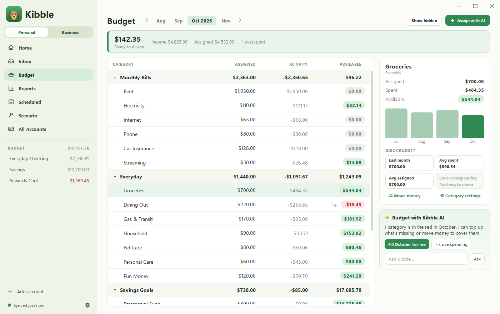
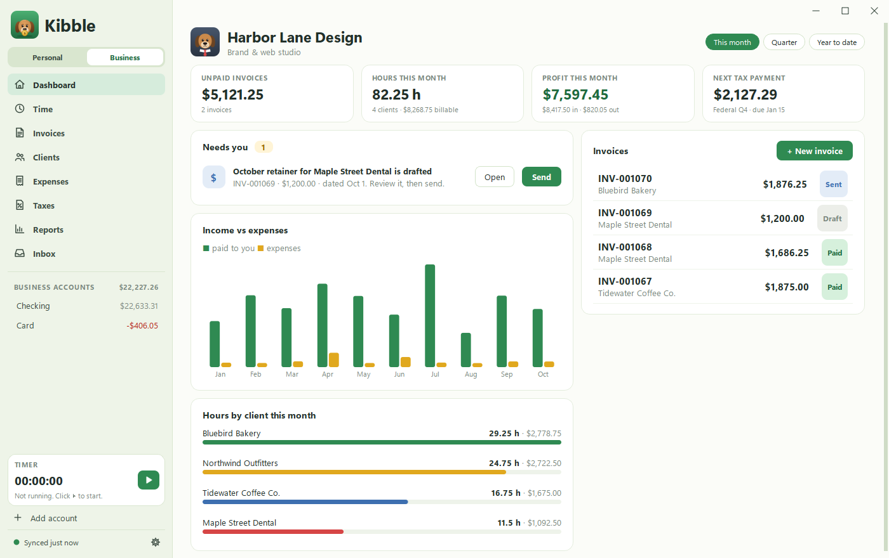

<h1 align="center">Kibble</h1>

<b>A friendly budget app for Windows, with a business side for freelancers.</b> Made by Soggy Dog Studios

<a href="https://github.com/Soggy-Dog-Studios/kibble/releases/latest/download/KibbleSetup.exe"><b>Download Kibble for Windows</b></a> · <a href="https://github.com/Soggy-Dog-Studios/kibble/releases">What's new</a>

## What it does

**Your budget**
- Give every dollar a job: a monthly budget with groups and categories, moving money between them in one click.
- Accounts, scheduled bills, reports and a "what if" scenario planner.
- Kibble AI (with your own Claude or ChatGPT plan) can fill a month in from your last three months, or fix overspending.

**Your inbox, read for you**
- Kibble can read your Gmail for receipts, card alerts, refunds and pay stubs, and lines them up in an Inbox.
- Nothing goes into your budget until you click Add. Kibble remembers each payee's account and category for next time.

**Your business** (optional)
- Track hours with a timer, by hand, or from Clockify. Turn them into PDF invoices and email them from your own address.
- Overdue reminders, monthly retainers, estimates, expenses by Schedule C line, mileage, and a Taxes screen with quarterly estimates and 1099s.
- Import from spreadsheets, QuickBooks, FreshBooks, Wave, Harvest or Toggl.

## Install

1. Download **KibbleSetup.exe** from the link above and open it.
2. Kibble installs just for you (no administrator rights needed) and walks you through setup.

Kibble updates itself: Settings > About checks for new versions. Every update is signed by Soggy Dog Studios, and
Kibble won't install one that isn't.

Needs Windows 10 or 11.

## Your data

Your budget is saved on your computer. Email passwords are kept in Windows Credential Manager.

## Questions

Visit [soggydogstudios.com](https://soggydogstudios.com).

---

Kibble is free to use under its license (shown in Settings > About). The source code isn't public.
